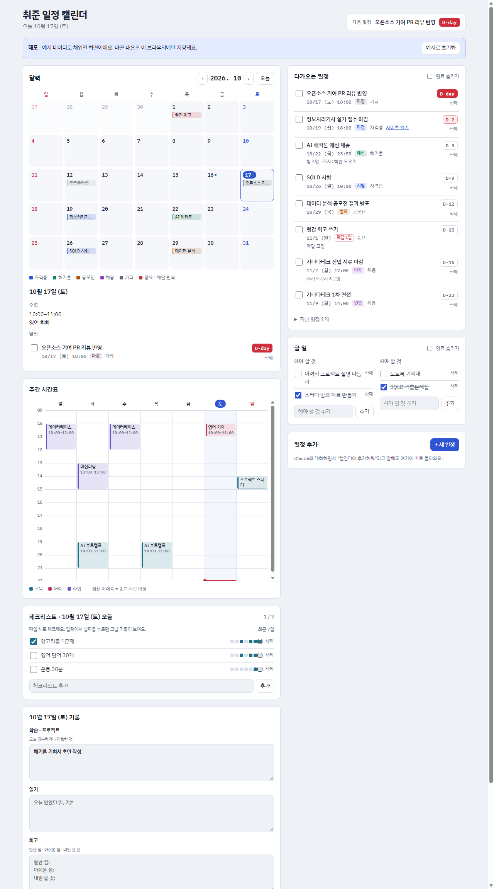

# 취준 일정 캘린더 (job-calendar)

자격증·해커톤·공모전·채용 일정, 주간 시간표, 매일 체크리스트, 하루 기록을 **한 화면**에서 관리하는 캘린더입니다.
설치 없이 HTML 파일 하나로 동작합니다.

**▶ 데모: https://sjzzang776.github.io/job-calendar/?demo**
(예시 데이터로 채워져 있고, 바꾼 내용은 내 브라우저에만 저장됩니다)

## 기능

| 영역 | 하는 일 |
|---|---|
| 월간 달력 | 분류별 색(자격증·해커톤·공모전·채용·기타)으로 일정 표시. 날짜를 누르면 그날 일정·수업·기록이 열림 |
| 다가오는 일정 | D-day 순서로 정렬, 3일 이내는 빨간색. 완료 체크, 지난 일정 접기 |
| 매달 반복 일정 | "매달 1일 월간 회고"처럼 같은 날짜에 반복 |
| 주간 시간표 | 요일·시간 격자에 수업 표시. 겹치는 수업은 나란히, 종료 시간 미정은 점선, 현재 시각 빨간 선 |
| 할 일 | 해야 할 것 / 사야 할 것 두 목록 |
| 체크리스트 | 매일 새로 체크하는 습관 목록. 최근 7일 기록이 점으로 보임 |
| 하루 기록 | 날짜별 학습·일기·회고. 입력을 멈추면 자동 저장, 기록이 있는 날은 달력에 점 |
| 다크 모드 | 시스템 설정을 따라 자동 전환 |

## 사용법

- **웹에서**: https://sjzzang776.github.io/job-calendar/ 를 열면 빈 캘린더로 시작합니다. 데이터는 브라우저(localStorage)에 저장됩니다.
- **내 PC에서**: `index.html`을 내려받아 브라우저로 열면 됩니다.
- **데모**: 주소 끝에 `?demo`를 붙이면 예시 데이터가 채워진 별도 공간으로 열립니다. 상단의 "예시로 초기화"로 처음 상태로 되돌릴 수 있습니다.

> 데이터는 브라우저마다 따로 저장됩니다. 다른 기기와 동기화되지 않고, 브라우저 데이터를 지우면 함께 지워집니다.

## Claude 아티팩트로 쓰면

원래 Claude 아티팩트로 만든 페이지입니다. Claude 안에서 열면 저장소가 Claude 쪽 데이터베이스로 바뀌어 기기 사이에 공유되고,
**"대화로 추가 · 수정"** 칸에 "다음 주 화요일 15시 면접 추가", "오늘 회고에 ○○ 추가"처럼 말로 일정을 고칠 수 있습니다.
GitHub Pages처럼 Claude 밖에서 열면 이 대화 기능은 꺼지고, 나머지는 브라우저 저장소로 그대로 동작합니다.

## 구조

- `index.html` 하나에 화면(CSS), 동작(JS), 저장소가 모두 들어 있습니다.
- 저장소는 `LocalDB`(localStorage)와 Claude 아티팩트 db가 같은 사용법(`collection().onSnapshot()`, `doc().set/update/delete`)을 쓰도록 맞춰져 있어, 실행 환경에 따라 자동으로 고릅니다.

## 라이선스

MIT
